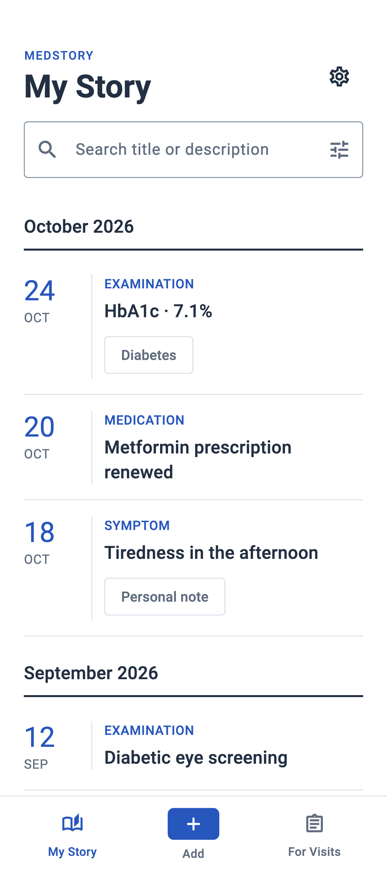
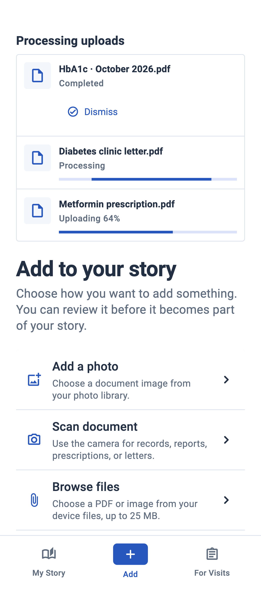
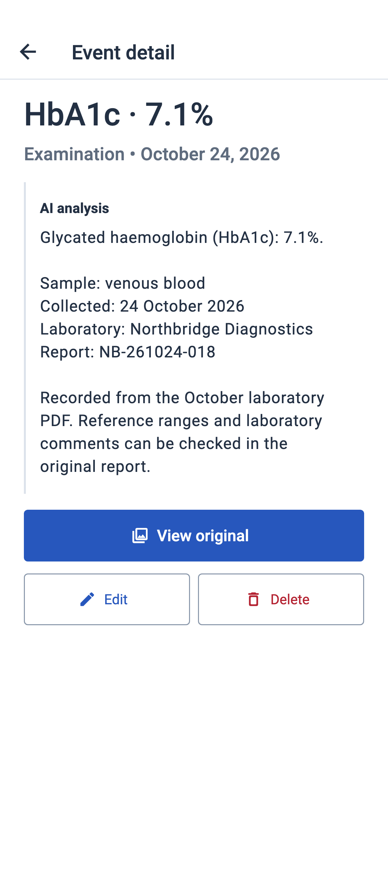
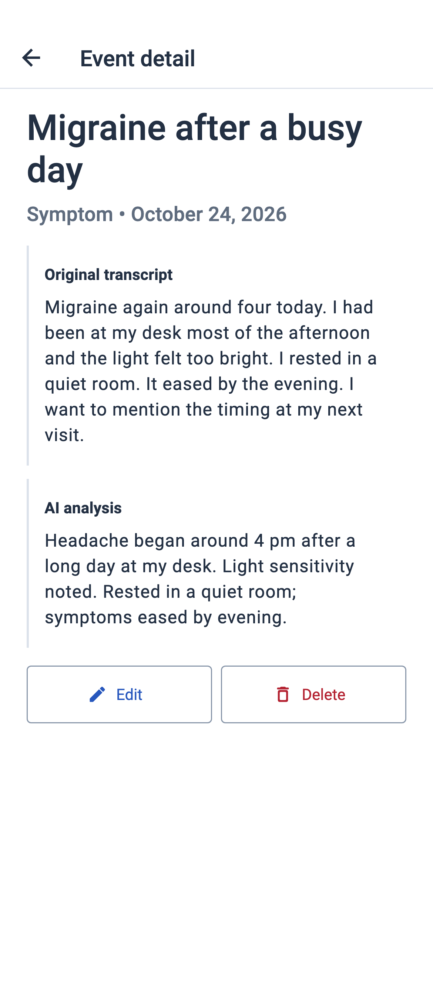
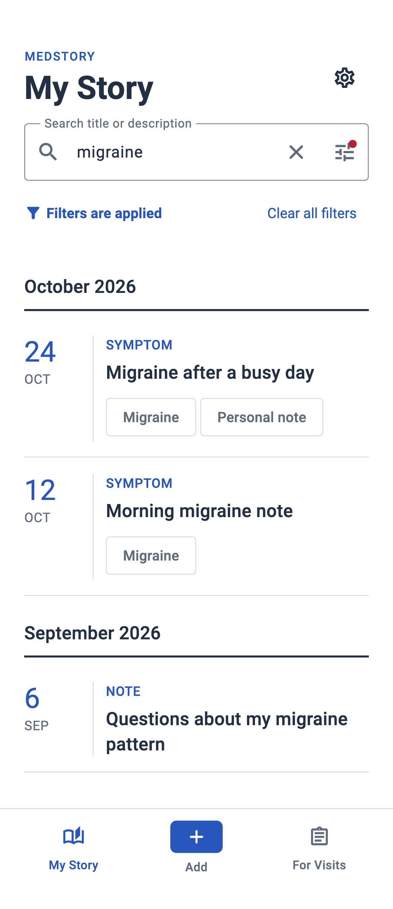
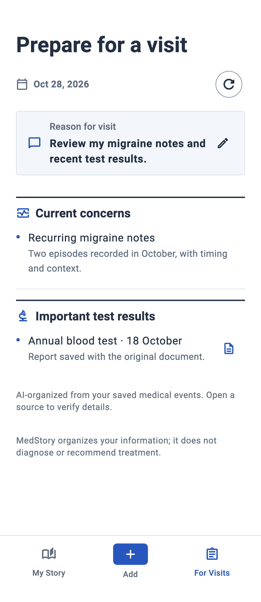
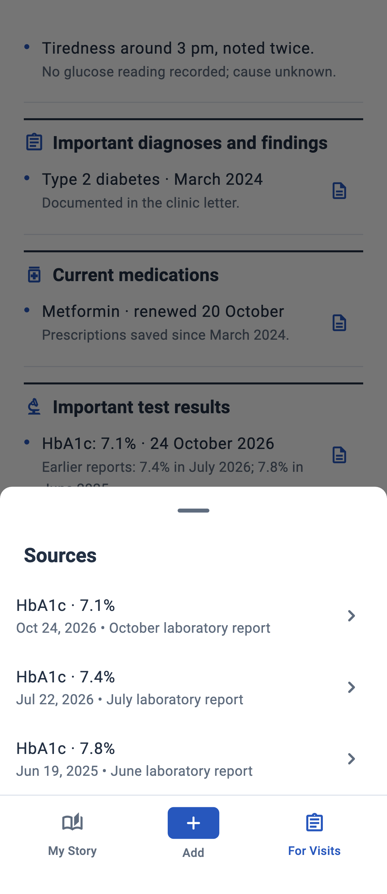

# MedStory

**Your medical history. Less searching. More perspective.**

A lab result in a patient portal. A prescription on paper. A specialist letter in your downloads. When you live with an ongoing condition, explaining your history can mean searching through all of them—and hoping you remember the rest.

MedStory brings documents, prescriptions, symptoms, and everyday notes into a searchable personal medical history. AI helps organize what you save, while the source stays connected so you can check the details.

**Three years of diabetes care. A new specialist. Your history already organized.**

Follow Alex, a fictional person living with type 2 diabetes, from the first clinic letter in 2024 to a specialist visit in 2026. The same history runs through every screenshot below. MedStory is built for people managing many kinds of chronic conditions and long medical histories.

<table>
  <tr>
    <td width="55%" valign="middle">
      <h3>A history that grows with you</h3>
      
Alex's latest HbA1c report, renewed metformin prescription, and afternoon tiredness notes sit in one dated timeline.

      
Earlier lab results, eye screening, clinic letters, and the original diagnosis are part of the same story.

      
When a new doctor asks what happened and when, the records are already together.

    </td>
    <td align="center">
      
    </td>
  </tr>
</table>

## From a folder of documents to records you can find

After a checkup, Alex adds a laboratory PDF, a clinic letter, and a prescription. The upload queue shows what is uploading, what is processing, and what is ready to open. You can also scan paper records or choose photos.

The completed HbA1c report becomes a dated record. Alex can inspect the extracted result, edit it if needed, and open the original PDF to check the laboratory comments.

<table>
  <tr>
    <th>Add the documents you already have</th>
    <th>Open the organized result</th>
  </tr>
  <tr>
    <td align="center"></td>
    <td align="center"></td>
  </tr>
  <tr>
    <td>A batch of records, with visible progress for each document.</td>
    <td>The result and date are searchable; the original stays a tap away.</td>
  </tr>
</table>

## Remember what never makes it into a report

“I felt really tired around three again today… I always forget to mention it.” Alex records a quick voice note. The original wording stays alongside the organized details, including what was not recorded. You can review the transcription before submitting it, or type a note instead.

Later, searching for **metformin** brings together prescriptions from 2024, 2025, and 2026. A question like “When did I first start taking this?” no longer means digging through old folders. Search by keyword, or narrow your history by year and record type.

<table>
  <tr>
    <th>Save the details you might forget</th>
    <th>Find the history behind a medication</th>
  </tr>
  <tr>
    <td align="center"></td>
    <td align="center"></td>
  </tr>
  <tr>
    <td>Keep your own words and the context around a symptom.</td>
    <td>Bring three years of related records into one view.</td>
  </tr>
</table>

## Meet a new doctor without starting from memory

Before the specialist visit, Alex adds a reason: review the results and medication history. MedStory organizes the saved history into a briefing with recorded concerns, the documented diagnosis, medications, and test results.

The summary links back to its sources. Open the HbA1c references to find the dated reports behind the numbers, then return to the original records when more detail matters.

<table>
  <tr>
    <th>Bring your story in order</th>
    <th>Check the records behind the summary</th>
  </tr>
  <tr>
    <td align="center"></td>
    <td align="center"></td>
  </tr>
  <tr>
    <td>A starting point for the conversation, built from what you saved.</td>
    <td>Every linked result leads back to a dated source record.</td>
  </tr>
</table>

*Actual Flutter screens rendered with fictional demo data and simulated processing states. No real patient records are shown. Available in English and Russian. [Screenshot details and regeneration](assets/screenshots/README.md).*

MedStory organizes and explains recorded information; it does not diagnose conditions or recommend treatment. AI output can be inspected and edited. Private originals are encrypted on the server, access is scoped to your account, and account deletion is available in settings.

## Behind the product

Built by **Alibek Kapan**, MedStory combines a Flutter client with Riverpod and Drift, a Django REST API, PostgreSQL, and Celery background processing. Engineering focuses on validated AI output, source traceability, user isolation, and interchangeable OCR, language-model, and speech-to-text providers.

The core experience is implemented; production launch checks remain in progress. Explore the [architecture](docs/technical-architecture.md), [AI pipeline](docs/ai-pipeline.md), [privacy design](docs/security-privacy.md), and [roadmap](docs/mvp-roadmap.md). For local development, start with the [backend workflow](backend/workflow.md) and [frontend guide](docs/frontend-architecture.md).

## License

Copyright © 2026 Alibek Kapan. **Source-available under the [PolyForm Noncommercial License 1.0.0](LICENSE).** Noncommercial use, modification, and redistribution are permitted subject to its terms. Commercial use requires separate permission.
