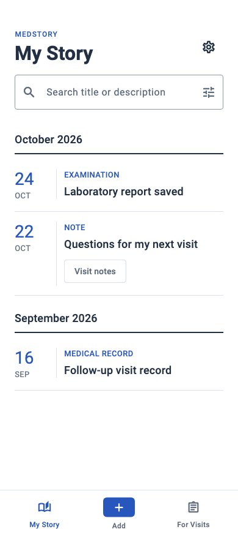
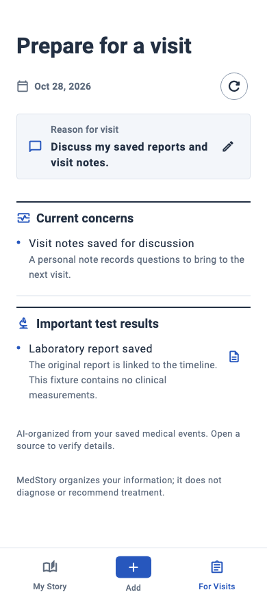
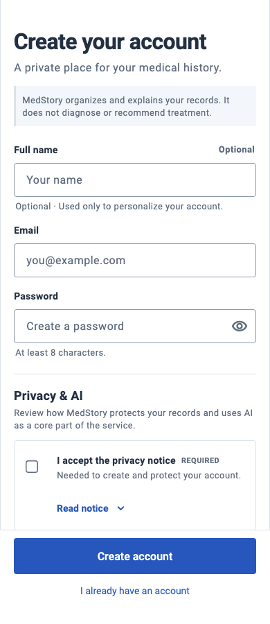
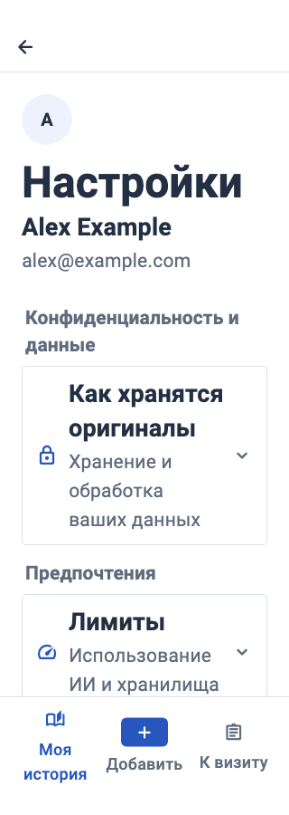

# Clear Index — Flutter implementation

Implemented 28 October 2026 against the existing Flutter screens and behavior. The 56-entry web prototype remains a visual reference. No design-generation run, backend/API/model/AI change, dependency change, new feature route, staging, or commit was part of this work. Preexisting dependency, picker, documentation, and backend-test edits were preserved.

## Applied system

- White `#FFFFFF`, ink `#233043`, secondary ink `#5F6C7E`, cobalt `#2757BD`, accent tint `#EDF2FC`, subtle surface `#F3F6FA`, divider `#DCE2EB`, input outline `#8997AA`.
- Flat 4dp controls/panels, restrained 12dp sheets/dialogs, fine rules, separate red destructive/error actions, medium/semibold hierarchy, readable wrapping content.
- Date-led timeline with localized month/year headings, cobalt day anchors, vertical record rules, and fine horizontal separators. Existing title/type/tag content and event ordering remain authoritative.
- Three equal vertical root destinations: 8dp column gaps, 8/16/4dp bar padding, minimum 64dp targets, 5dp icon/label gap, 22dp icons, 52×28dp ordinary wrappers, 52×32dp cobalt Add wrapper with 6dp radius, 12dp labels. The divider paints within the bar; normal content height is 76dp. Device safe area is added once. Labels wrap and increase the bar height.
- `AppShell` still dispatches the same `StatefulNavigationShell.goBranch` call with the same `initialLocation` expression. Routes, redirects, branch ownership, active-tab reset, and back behavior are unchanged. Navigation retains localized tab-position announcements, selected/enabled semantics, and destination tooltips.
- No visible strings were added: existing English/Russian localization helpers and localized date formatting are used. Document status labels reuse the existing translated status helper.

## Screen-by-screen coverage

“Shared theme” means the working screen/control remains in place with the new palette, fields, buttons, app bars, or modal styling. It does not imply a prototype flow was substituted.

| Existing screen / overlay | Visual implementation | Behavior and verification coverage |
|---|---|---|
| Session splash `/` | White canvas/cobalt indicator; shared typography | Existing restoration/auth guards untouched; no new session logic |
| Sign-in `/login` | Cobalt actions, flat fields, restrained heading/error notice | Production widget capture; authentication repository tests retained |
| Registration `/register` | Flat white fields, ruled disclosure, restrained consent panel, red validation | Single acceptance, disclosure expansion/focus, password visibility, real submitted values/network error, narrow Russian, keyboard/footer tests |
| Email verification `/verify-email` | Shared fields/buttons and lighter heading | Existing six-digit verification/authentication test; resend/status code unchanged |
| Password reset `/forgot-password` | Shared controls and heading | Existing request → code/new-password state test; completion flow unchanged |
| First-use onboarding sheet | Cobalt icon, 12dp sheet, shared type/buttons | Same storage flag, non-dismissible configuration, Start/Skip callbacks and destinations; manual device first-launch check outstanding |
| Timeline `/timeline` | Brand eyebrow, My Story heading, localized month rules, date rails, flat rows | New real-controller search, clear, type-filter apply/reset, pagination, offline refresh/cached rows, event-route and back-state tests; Russian320/200% wrapping |
| Timeline filter/year overlays | Shared modal/checkbox/button/date-picker palette and restrained title | Same year picker, selection state, Apply/Clear callbacks; filter regression exercises existing sheet |
| Root navigation on three branches | Quiet Ledger geometry in Clear Index colors; growing labels | Branch draft/nested-route retention, middle-tab callback, route/back/pop tests; English geometry and Russian320/scaled tap targets/safe-inset assertions |
| Add `/capture` | Divided action groups, compact icons, flat notices | Same native picker/camera/file/note callbacks; existing cancel/unknown-size picker test retained |
| Photo grouping pushed screen | 4dp selections, cobalt selection, scrollable choices | Russian375/150% grouped/separate selection; exact single-bundle versus independent-draft assertions |
| Ordered document pages pushed screen | Flat previews; full hint text; same drag/remove controls reflow below text | Accessible reorder action, add, remove, exact ordered bundle submission. Native drag gesture itself remains unverified |
| Upload/processing queue | Flat panels, full titles, wrapped actions, semantic error red | Existing queue/controller duplicate/retry/ownership tests; new Retry/Dismiss IDs and completed result-route regression |
| Capture recording/review/failure panels | Shared flat panels and cobalt action hierarchy | Recording permission/cancel/size tests retained; same real voice state machine/retry/discard controls |
| Quick note `/notes/new` | Muted helper, shared editor/actions, recording rule | Russian375/150% async recording/transcription test preserves latest typed edits and exact submitted text; existing navigation/polling lifecycle tests |
| New/edit event `/events/new`, `/events/:id/edit` | Shared fields/date controls; expanded wrapping type dropdown; error notice | Narrow Russian hydrated editing, required validation, exact saved title/description/tags, preserved remaining fields and saved-event route |
| Event detail `/events/:id` | Restrained title, ruled source panels, squared provenance badges, red deletion | Original-source opening/unavailable feedback/temporary cleanup tests retained; cancel/confirm deletion regression |
| Original viewer pushed from event | Shared app bar/buttons; squared page indicator | Existing pages, swipe, native PDF opening, online source retrieval, Download/Share, cleanup callbacks unchanged. Platform sharing/downloading not exercised end to end |
| Document library `/documents` | White divided rows, translated statuses, shared filter sheet | Existing search/status query/load/retry behavior retained; no new prototype library controls |
| Document detail `/documents/:id` | Ruled metadata/source panels, wrapping label columns, squared badges, red deletion | Narrow Russian320/200% metadata scrolling; existing no-explanation-fetch contract; cancel/confirm deletion preserves separate event data |
| Summary `/summary` | Ruled sections, readable full dates/reason, restrained body text | Real-controller tests cover explicit regeneration, pending state, replacement only on success, cached content after failure; existing legacy/source policies retained |
| Visit-reason dialog | Shared 12dp dialog and fields/buttons | Full saved reason, hydrate/edit/save, no implicit generation, save-failure feedback, narrow Russian320/200% |
| Summary sources sheet | Shared modal typography/buttons/rows | Existing single-source direct and multiple-source selection code retained; platform/device journey still outstanding |
| Visit preparation `/visit-preparation` | Shared controls; scrolling keeps existing actions reachable | Narrow Russian320/200% test verifies normalized final reason saves before existing PDF export; no generation on save |
| Settings `/timeline/settings` | Flat divided groups, cobalt links, restrained profile, responsive stacked profile at narrow/large text | Inline privacy/usage/language disclosure, locale update, direct/deep-link back/pop, logout, typed deletion/cancel tests; Russian320/150% |
| Event/document/account confirmation dialogs | 12dp outlined white modal, restrained title, red destructive action | Same dismissal/confirmation logic; localized scrolling dialogs covered by deletion tests |
| Loading/error/empty/offline states | Shared palette/type/progress and flat notices | Timeline offline/empty, upload failure/retry, voice transitions, auth validation/error, cached summary pending/failure and unavailable source checks; not all states independently screenshotted |

## Intentional deferrals and retained presentations

1. **IBM Plex Sans:** supplied web fonts are Latin-only WOFF2 subsets. No suitable full Cyrillic-capable app font asset was available in the provided files. The existing platform font remains; no runtime font download, dependency, mixed Latin-only family, or package upgrade was introduced. A future font-only change should bundle the licensed full glyph set and verify both languages/weights.
2. **Review inbox, explanation screen, selective revision comparison:** domain/repository/localization support does not establish working screen wiring. The current router/screens have no dedicated review or revision flow, and the document-detail test explicitly requires no explanation fetch/presentation. These prototype screens were not added.
3. **Prototype navigation/content alternatives:** no subject switcher, review counter, quick type tabs, added preview/source facts, onboarding route, replacement recording screens, source-copy sheet, or intermediate confirmation/review step was introduced. Existing search/filter controls, pushed capture routes, full note editor, metadata details, and source viewer remain.
4. **Settings/auth layout and flows:** settings stays inside the timeline shell and retains its root bar/back gesture. Privacy/usage/language stay inline. Logout retains its existing direct callback; account deletion retains the existing typed confirmation. Registration keeps its existing scroll/focus/keyboard handling and pinned action footer. Authentication layouts are restyled in place rather than replaced with prototype compositions.
5. **Summary contracts:** the existing section/item limits, legacy mapping, current-concerns source policy, explicit refresh triggers, saved-reason behavior, cached content, and PDF export location remain. No JSON export UI or prototype export chooser was added.
6. **Native/platform controls:** file/photo/camera pickers, permissions, date pickers, native PDF opening, OS Download/Share and microphone behavior retain their platform presentation and implementations. Widget tests cannot establish live OS or service acceptance.

No working feature was removed to make the prototype fit. Responsive fixes only reflow existing controls: grouping/visit preparation scroll, queue actions wrap, page controls remain reachable, document metadata wraps, and event-type choices expand vertically. These fixes retain the original callbacks and state ownership.

## Verification environment

The default PATH Flutter is 3.44.4/Dart3.12.2 and cannot resolve the app's **preexisting** Dart `^3.13.0`/Flutter `>=3.47.6` requirement. Its initial `flutter analyze` and `flutter test` attempts stopped at version resolution. The old `.dart_tool/package_config.json` also referenced a removed temporary SDK.

Verification used an isolated local checkout at `/private/tmp/medstory-clear-index-flutter`, pinned to the app/CI's Flutter 3.47.6/Dart 3.13.5. Existing lockfile resolution succeeded with `pub get --enforce-lockfile`; dependency declarations and lockfile were not edited for this redesign. The default installed SDK was not upgraded.

A recovered baseline in `/private/tmp/medstory-clear-index-baseline/frontend` used HEAD source plus the preexisting dependency/picker edits and original picker regression. It passed analysis with no issues and **67 tests, zero failures**. No preexisting source/test failure remains after using the required SDK.

Final verification with that SDK:

| Check | Result |
|---|---|
| `flutter analyze` / final `flutter analyze --no-pub` | No issues |
| `flutter test` / final `flutter test --no-pub` | **84 passed, zero failures**; 12 opt-in render tests skipped as intended |
| Opt-in screenshot run | **12 passed**; all resulting frames visually inspected |
| Narrow/localized layouts | 320px/375px; Russian150–200% text depending on screen; normal390px reference captures |
| Root navigation | Equal targets, reference wrapper sizes, normal76dp content, localized growth and one safe inset checked |
| `git diff --check` | Passed |

New regressions add behavioral coverage without removing existing assertions. They cover tab/nested-route retention, timeline search/filter/refresh/pagination/offline content, capture grouping/ordering/retry/result routing, voice-text preservation, event validation/edit/delete, document deletion, saved reason/export order, explicit summary generation and cached pending/failure states, and localized settings/logout/deletion controls. Test files live in [frontend/test](../../../frontend/test/).

The first redesigned runs found issues in new test harness assumptions (which scrollable to use, off-screen edit targets, painted-border height, and test font loading). Those were corrected without weakening the behavior assertions. Rendered narrow-text checks also found cramped page hints, a Russian event dropdown overflow, and a split settings heading; the safe reflows are recorded above.

**Still unverified:** physical iOS/Android devices, live backend/service authentication/upload/transcription/generation/export/deletion, actual microphone/camera/OS picker permission flows, native drag gesture, platform file sharing/downloading/PDF rendering, and screen-reader operation. Widget tests mock those service/platform boundaries and do not establish production integration acceptance. No device or live destructive action was performed.

The default PATH still selects the older SDK. Use the existing CI-required compatible version (or the temporary checkout above) when reproducing these checks; changing dependencies to accommodate the older SDK is outside this redesign.

## Actual Flutter captures

Captures come from production widgets rendered by Flutter widget tests with in-memory synthetic fixtures. No real account/health record or prototype web composition is used. They are **Flutter test-renderer captures**, not device screenshots. Normal frames use 390×900; enlarged Russian frames use 320/375px widths and 150% text, with simulated 24dp safe insets. SDK Roboto/Material Icons are loaded only in the opt-in test to make text/icons readable; no screenshot fixture/font override enters the application.

See the [12-frame screenshot index](flutter-screenshots/README.md) for individual PNGs, including enlarged Russian history/note frames. Reproduce from `frontend/` with the compatible SDK:

```sh
/private/tmp/medstory-clear-index-flutter/bin/flutter test --no-pub \
  --dart-define=CLEAR_INDEX_SCREENSHOTS=true \
  --dart-define=FLUTTER_SCREENSHOT_SDK=/private/tmp/medstory-clear-index-flutter \
  test/clear_index_visual_test.dart
```

The regular suite skips this opt-in capture harness. It does not create screenshots or load synthetic application content at runtime.

| My Story | Add | For Visits |
|---|---|---|
|  |  |  |

| Registration | Event | Settings at enlarged Russian text |
|---|---|---|
|  |  |  |
